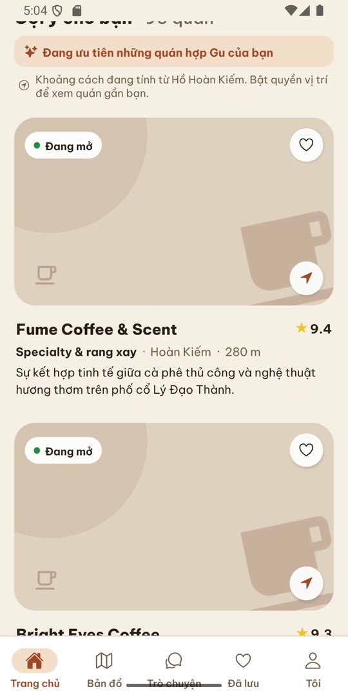

# Gu Hà Nội

**Trang giới thiệu & demo:** https://dotu202.github.io/guhanoi_legal/
**Chính sách quyền riêng tư:** https://dotu202.github.io/guhanoi_legal/privacy.html

Gu Hà Nội là ứng dụng di động gợi ý quán cà phê ở Hà Nội theo "gu" cá nhân (khu vực, phong cách, đồ uống, mức giá). Đây là dự án cá nhân do mình tự xây dựng toàn bộ: app, API và cơ sở dữ liệu. Repo này chỉ chứa trang giới thiệu, video demo và chính sách quyền riêng tư; **mã nguồn của ứng dụng để private**, liên hệ nếu bạn muốn xem cùng trong buổi trao đổi.

*Gu Hà Nội is a mobile app that recommends Hanoi coffee shops by personal taste. It is a solo, end-to-end project (React Native app, NestJS API, PostgreSQL). This repo only hosts the showcase page, a demo video and the privacy policy; the app source is private.*

## Demo

- Video 40 giây quay trên Android emulator: [`assets/gu-demo.mp4`](assets/gu-demo.mp4) (xem trực tiếp trên [trang giới thiệu](https://dotu202.github.io/guhanoi_legal/)).
- Dữ liệu trong demo là dữ liệu mẫu (95 quán). Ảnh quán đang là ảnh giữ chỗ.

## Tính năng

- **Người dùng:** hồ sơ "Gu của bạn", Trang chủ ưu tiên quán hợp gu, khoảng cách, bản đồ, lưu quán, đánh giá trải nghiệm.
- **Trợ lý AI:** hỏi bằng tiếng Việt tự nhiên, AI hiểu ý định (Gemini) và gợi ý quán bằng embedding vector.
- **Chat:** nhắn tin trực tiếp với chủ quán, thông báo đẩy.
- **Chủ quán:** đăng ký quán, cập nhật giờ mở cửa và thực đơn, trả lời đánh giá, hộp thư khách, thống kê.
- **Admin:** duyệt yêu cầu, quản lý danh mục quán, xử lý báo cáo, nhật ký kiểm toán.
- **Tài khoản:** đăng ký email có xác minh mã, quên mật khẩu, đăng nhập Google.

## Công nghệ

| Lớp | Công nghệ |
| --- | --- |
| Mobile | React Native 0.88, Expo 58, TypeScript, React Navigation, TanStack Query, react-native-maps, Jest |
| Backend | NestJS 12 (ESM), Prisma 7, REST + Swagger, JWT, rate limiting, helmet, Vitest (unit + e2e) |
| Dữ liệu | PostgreSQL + PostGIS + pgvector (embedding 768 chiều), Redis cache |
| AI | Google Gemini (phân tích ý định, embedding) |
| Dịch vụ | Cloudinary (ảnh), Gmail API (email), Expo push, Render + Neon (free tier) |
| CI | GitHub Actions: lint, build, unit, e2e, typecheck, jest, tự chạy migration khi merge vào main |

Dự án chỉ dùng dịch vụ miễn phí, không cần gắn thẻ thanh toán.

## Liên hệ

Đỗ Minh Tú, mhtu1213@gmail.com, https://github.com/DoTu202
